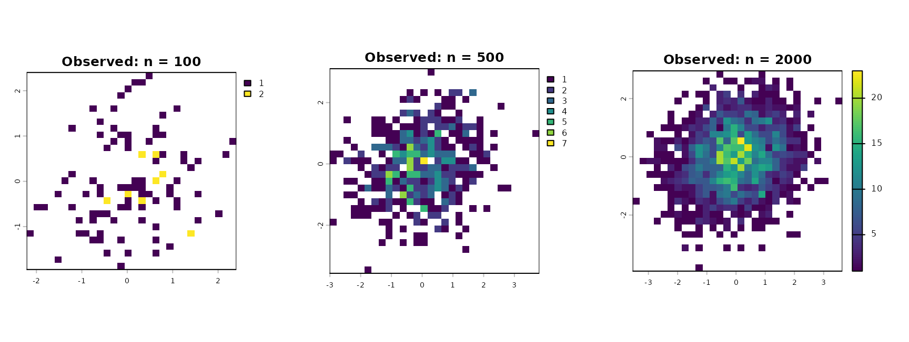
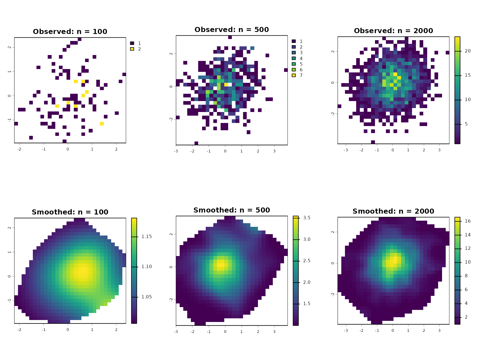
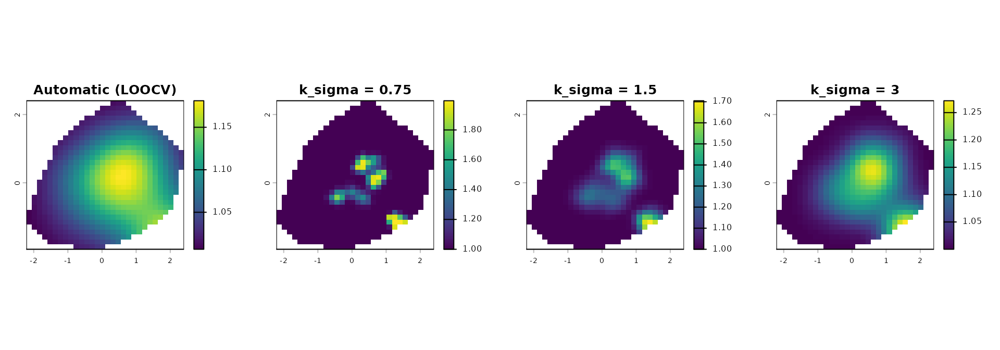
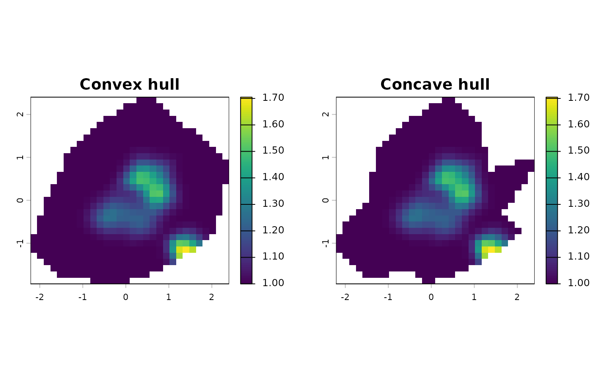
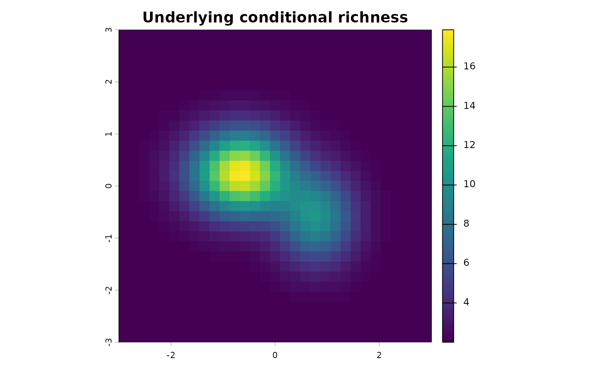
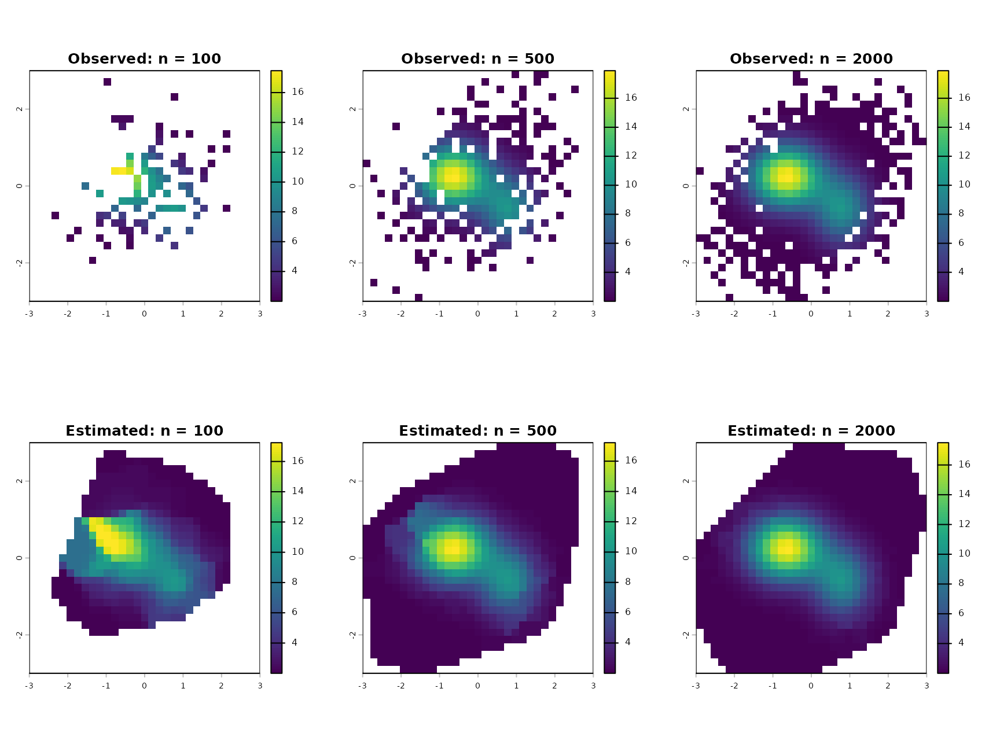

# From incomplete environmental and attribute spaces to continuous estimates

## The problem: observations cover only part of ecological space

Ecological data rarely provide a complete picture of the combinations of
conditions or organismal attributes that could occur. Biodiversity is
usually represented geographically, but many questions concern other
coordinate systems. In environmental space, each axis can represent a
climatic or habitat variable. In attribute space, axes represent species
properties, such as body size, dispersal capacity, or functional traits.
A raster cell in either representation identifies a combination of
values, not a geographical location.

Even when observations are collected without deliberate bias, a finite
sample covers only part of a continuous distribution. As a result, a
raster constructed from sampled species or surveyed sites may contain
many empty cells. This is especially relevant at local scales, where the
number of sampled organisms, species, or sites may be small relative to
the diversity of potentially represented combinations.

An empty cell has several possible interpretations. It may represent a
condition that was not sampled, a combination that is rare, or a
combination that is genuinely absent from the ecological system. These
possibilities cannot be distinguished from the raster alone.
Interpreting every empty cell as a biological zero risks confusing
incomplete observation with ecological absence. Conversely, assuming
that every empty cell should contain biodiversity can introduce
unsupported predictions.

### Theoretical and observed spaces

The *theoretical space* represents the set of possible combinations of
variables within a multidimensional system. Its boundaries can be
defined by the ranges of the selected axes, but also by the biological,
environmental, and physical constraints that determine which
combinations can actually exist. For example, in environmental space,
the relationships among temperature, precipitation, and other climatic
variables constrain the combinations that can occur under Earth’s
physical and climatological processes. Similarly, in attribute space,
evolutionary history, physiological limitations, and functional
trade-offs constrain the combinations of traits that species can
exhibit. Consequently, the theoretical space is not necessarily
equivalent to the complete Cartesian product of the selected variables,
since some combinations may be physically impossible, biologically
unfeasible, or inaccessible under the conditions being considered.

The *observed space*, in contrast, corresponds to the subset of these
combinations represented by the available data. Its extent and internal
structure depend not only on the underlying distribution of
environmental conditions or biological attributes, but also on sampling
effort, spatial and temporal coverage, and the resolution used to
discretize the space. Incomplete sampling may therefore produce a
fragmented representation of an otherwise continuous distribution,
particularly at local scales or when relatively few observations are
available. Importantly, the absence of observations from a particular
combination does not necessarily indicate that the combination is
theoretically impossible or biologically unoccupied.

In practice, the full extent of the theoretical space is rarely known.
One possible approximation is to define a rectangular domain from the
observed ranges of the variables, thereby establishing an operational
space within which unobserved combinations can be explored. However,
this rectangular extent may simultaneously exclude feasible combinations
beyond the observed ranges and include combinations that violate
biological or environmental constraints. Kernel-based smoothing offers a
complementary approach by estimating values between observed
combinations, potentially recovering continuous patterns obscured by
limited sampling. Combined with geometric boundaries, such as convex or
concave hulls, this approach provides a practical means of approximating
patterns within a potentially broader theoretical space, although it
cannot independently identify its true biological or physical limits.

We begin by illustrating this problem using simulated species traits.
Independent samples of different sizes are drawn from the same
underlying multivariate distribution, demonstrating how the
representation of attribute space changes with sampling effort. We then
introduce
[`lets.smooth()`](https://brunovilela.github.io/letsR/reference/lets.smooth.md)
as an exploratory approach to estimating continuous patterns from
incomplete observations, examining how kernel bandwidth and geometric
constraints influence the resulting representation of ecological space.

## Required packages

This vignette uses the `letsR` package to construct and explore
environmental and attribute spaces, and the `terra` package for raster
manipulation and visualization.

``` r

library(letsR)
library(terra)
```

## Seeing the problem: finite samples in attribute space

A sample of trait values drawn from a continuous distribution is already
incomplete relative to its underlying population distribution. There is
no need to remove occupied cells artificially to demonstrate this
property. Instead, we generate independent samples of 100, 500, and
2,000 hypothetical species from the same bivariate normal distribution.
Each species has one pair of correlated traits, and all generated
records are retained.

The sampling distribution is held constant, and sample size is the only
feature intentionally varied. A larger sample should generally cover
more combinations of traits and yield a less fragmented discretized
representation. Importantly,
[`lets.attrpam()`](https://brunovilela.github.io/letsR/reference/lets.attrpam.md)
counts the species assigned to each attribute-space bin. Its raw
richness values are consequently affected by the number of species
sampled, and the resulting rasters should not be interpreted as directly
comparable estimates of total richness at different sample sizes.

``` r

set.seed(1)
sample_sizes <- c(100L, 500L, 2000L)

simulate_traits <- function(n) {
  trait_a <- rnorm(n)
  trait_b <- 0.2 * trait_a + rnorm(n)
  data.frame(
    Species = paste0("sp", seq_len(n)),
    trait_a = trait_a,
    trait_b = trait_b
  )
}

trait_samples <- lapply(sample_sizes, simulate_traits)
attr_spaces <- lapply(trait_samples, lets.attrpam, n_bins = 30)
richness_rasters <- lapply(attr_spaces, function(z) z$Attr_Richness_Raster)

op <- par(mfrow = c(1, 3), mar = c(3, 3, 3, 2))
for (i in seq_along(richness_rasters)) {
  plot(richness_rasters[[i]],
       main = paste("Observed: n =", sample_sizes[i]))
}
```



``` r

par(op)
```

We can summarize how many attribute-space cells have recorded species in
each sample:

``` r

attribute_coverage <- data.frame(
  n_species = sample_sizes,
  occupied_bins = vapply(
    richness_rasters,
    function(r) sum(!is.na(terra::values(r, mat = FALSE))),
    integer(1)
  )
)
attribute_coverage$proportion_occupied <-
  attribute_coverage$occupied_bins / 30^2
print(attribute_coverage, row.names = FALSE)
#>  n_species occupied_bins proportion_occupied
#>        100            92           0.1022222
#>        500           265           0.2944444
#>       2000           408           0.4533333
```

The figures show the central difficulty: the same generating process can
give rise to different observed attribute spaces simply because a
different number of species is sampled. A gap between sampled bins
cannot, on its own, establish a gap in the underlying trait
distribution. The next step is to ask whether the observed values can
support a provisional estimate between sampled combinations.

## A possible solution: smoothing values with `lets.smooth()`

[`lets.smooth()`](https://brunovilela.github.io/letsR/reference/lets.smooth.md)
offers an exploratory way to estimate a continuous raster response from
observed cells. It uses Gaussian kernel regression, optionally limiting
the estimated surface to a convex or concave hull around those cells.
The method addresses gaps in the raster response, not the detection of
unrecorded species or the reconstruction of the true bounds of
ecological space.

### How does `lets.smooth()` work?

The procedure is not restricted to species richness. It can be applied
to any continuous numerical variable represented in a raster, including
functional diversity, phylogenetic diversity, environmental
characteristics, or other ecological attributes. The function estimates
values across the underlying space based on the observed raster values,
regardless of the ecological meaning of the variable. Recorded zeros are
treated as observations, whereas `NA` values represent unknown values.

For a target cell at position $`\mathbf{x}`$, the function calculates a
Gaussian-weighted mean of observed raster values:

``` math
\widehat{Z}(\mathbf{x}) =
\frac{\sum_{i=1}^{n} Z_i\,K_{\sigma}(\lVert\mathbf{x}-\mathbf{x}_i\rVert)}
     {\sum_{i=1}^{n} K_{\sigma}(\lVert\mathbf{x}-\mathbf{x}_i\rVert)},
\qquad
K_{\sigma}(d)=\exp\left(-\frac{d^2}{2\sigma^2}\right).
```

Here, $`Z_i`$ is the observed value of the variable of interest in cell
$`i`$, which may represent species richness or any other numerical
attribute stored in the raster. The term $`d`$ is the Euclidean distance
between cells in the represented space, and $`\sigma`$ is the bandwidth.
The estimator is a form of Nadaraya-Watson kernel regression. It
calculates a weighted mean, rather than a sum of observations or a
probability density.

The bandwidth is specified relative to the raster resolution:

``` math
\sigma = k_{\sigma} \times \operatorname{mean}\big(\operatorname{res}(x)\big).
```

A smaller `k_sigma` gives more weight to nearby observations and retains
finer variation. A larger value produces broader, smoother gradients.
The implementation computes contributions from all observed cells,
avoiding the artificial absence of estimates where a finite focal window
contains no observations. This does not mean that predictions far from
observed cells are reliable.

By default,
[`lets.smooth()`](https://brunovilela.github.io/letsR/reference/lets.smooth.md)
uses `k_sigma = "auto"`. The bandwidth multiplier is selected by
leave-one-out cross-validation (LOOCV), which evaluates how well each
observed cell can be predicted from all the other observed cells. For a
candidate multiplier $`k`$, the selection criterion is:

``` math
\operatorname{CV}(k) = \frac{1}{n}\sum_{i=1}^{n}
  \left[Z_i - \widehat{Z}_{-i}(\mathbf{x}_i;k)\right]^2,
\qquad
k_{\mathrm{opt}} = \underset{k \in [0.25,\,10]}{\arg\min}\;\operatorname{CV}(k),
```

where $`\widehat{Z}_{-i}`$ denotes the kernel estimate made without
using the value of cell $`i`$. The implementation evaluates 30
logarithmically spaced multipliers between 0.25 and 10 and, when
appropriate, refines the best candidate numerically. If all observed
raster values are identical, the cross-validation criterion cannot
distinguish bandwidths and the function uses `k_sigma = 1`. An explicit
numerical value, such as `k_sigma = 1.5`, bypasses optimization. The
automatically selected multiplier is printed when the function runs, but
the function returns only the smoothed raster.

LOOCV minimizes prediction error *among the observed cells*, rather than
error against the unknown theoretical distribution. The selected
bandwidth may also reach the limits of the search interval. In
particular, the presence of spatial dependence, irregular sampling
intensity, and systematic differences between sampled and unsampled
combinations can limit how well LOOCV performance transfers to
unobserved regions.

Distances are calculated in the coordinate units of the raster.
Environmental or trait variables with different units or markedly
different variation should be transformed or standardized before
constructing the space. Otherwise, one axis may dominate the distance
calculation.

### Where should predictions be retained?

The smoothing calculation can be performed over the entire raster
(`restrict = FALSE`) or restricted to a geometric hull enclosing
observed cells (`restrict = TRUE`). A convex hull provides a broad
interpolation domain, whereas a concave hull can follow the arrangement
of observations more closely. Both are geometric assumptions rather than
estimates of ecological feasibility. In particular, a hull can include
poorly supported combinations and a concave hull can exclude plausible
unsampled combinations.

## Applying the solution to the sampled attribute spaces

We now apply
[`lets.smooth()`](https://brunovilela.github.io/letsR/reference/lets.smooth.md)
to the three richness rasters shown above, without deleting observations
or manually constructing missing-value patterns. Cells without a
recorded species are represented as missing bins in the attribute-space
raster. The default `k_sigma = "auto"` selects a potentially different
bandwidth for each sample using LOOCV. This is appropriate when the goal
is prediction for each dataset, although it means differences between
smoothed surfaces reflect both the sampled data and the selected
bandwidth.

``` r

smoothed_rasters <- lapply(richness_rasters, function(r) {
  lets.smooth(
    x = r,
    k_sigma = "auto",
    restrict = TRUE,
    type_hull = "convex"
  )
})
#> Selected k_sigma (LOOCV): 4.6546
#> Selected k_sigma (LOOCV): 1.7102
#> Selected k_sigma (LOOCV): 1.0081

op <- par(mfrow = c(2, 3), mar = c(3, 3, 3, 2))
for (i in seq_along(richness_rasters)) {
  plot(richness_rasters[[i]],
       main = paste("Observed: n =", sample_sizes[i]))
}
for (i in seq_along(smoothed_rasters)) {
  plot(smoothed_rasters[[i]],
       main = paste("Smoothed: n =", sample_sizes[i]))
}
```



``` r

par(op)
```

Smoothing produces continuous surfaces inside each selected hull, even
when a relatively small sample occupies few raster cells. The messages
above report the multipliers selected for the corresponding samples. The
estimates are conditional on the recorded richness values and the
selected bandwidth. They do not recover the unobserved identities of
species, nor do they estimate how many additional species would appear
if a sample of 100 species were increased to 2,000.

For a quick side-by-side display, `plot_raster = TRUE` plots the
original and smoothed rasters directly. The argument is optional and
does not change the estimated values.

``` r

lets.smooth(
  richness_rasters[[2]],
  k_sigma = "auto",
  type_hull = "convex",
  plot_raster = TRUE
)
```

### Sensitivity to the kernel bandwidth

For the smallest sample, the choice of bandwidth particularly influences
the spatial spread of observations. We compare three user-defined
multipliers with the LOOCV-selected result for the same data. This
comparison separates the effect of smoothing choices from changes in the
observations.

``` r

r_sparse <- richness_rasters[[1]]
bandwidths <- c(0.75, 1.5, 3)

estimates <- lapply(bandwidths, function(k) {
  lets.smooth(
    x = r_sparse,
    k_sigma = k,
    restrict = TRUE,
    type_hull = "convex"
  )
})

op <- par(mfrow = c(1, 4), mar = c(3, 3, 3, 2))
plot(smoothed_rasters[[1]], main = "Automatic (LOOCV)")
for (i in seq_along(estimates)) {
  plot(estimates[[i]], main = paste("k_sigma =", bandwidths[i]))
}
```



``` r

par(op)
```

Small bandwidths emphasize local variation, while large bandwidths
distribute the influence of observed richness over a broader region. The
LOOCV choice represents the best fit within the predefined search
procedure for predicting observed cells. A smooth surface should not be
confused with strong observational support. Where the sample is small,
different bandwidths can yield markedly different results.

### Exploring the hull assumption

A convex hull contains all observed cell centroids but may include
combinations not represented by the sample. A concave hull can follow
the sampled domain more closely, although its outline depends on a
tuning parameter and may itself exclude plausible but unsampled
combinations.

``` r

# Keep the bandwidth fixed to isolate the effect of hull geometry
r_convex <- lets.smooth(
  x = r_sparse,
  k_sigma = 1.5,
  restrict = TRUE,
  type_hull = "convex"
)
r_concave <- lets.smooth(
  x = r_sparse,
  k_sigma = 1.5,
  restrict = TRUE,
  type_hull = "concave_ratio",
  param = 0.5
)

op <- par(mfrow = c(1, 2))
plot(r_convex, main = "Convex hull")
plot(r_concave, main = "Concave hull")
```



``` r

par(op)
```

Changing the hull changes where predictions are retained, not their
underlying Gaussian kernel estimates at cells shared by both domains,
provided the bandwidth is held fixed. Neither hull establishes the true
boundary of a functional or environmental hypervolume.

## A second problem: limited environmental coverage in local surveys

The same distinction matters when cells represent environmental
combinations rather than species traits. A relatively small survey may
cover only a narrow subset of conditions available in a landscape, and
environmental cells without surveys should not automatically be assigned
a richness of zero. To examine when smoothing is informative, we can
simulate an environmental response that is known everywhere and evaluate
predictions at cells without survey observations.

Species counts per attribute-space bin increase mechanically with sample
size. To investigate prediction error without this confounding effect,
we consider a different simulation: a known continuous richness response
in a fixed two-dimensional environmental space. We independently sample
100, 500, and 2,000 survey locations from the same bivariate normal
distribution, and at each location we record the underlying richness
response. No survey locations are deliberately discarded to create
missingness. Only locations inside the predefined raster domain
contribute to its cells. Multiple survey locations can fall into the
same raster cell, so the number of cells containing an observation is
usually smaller than the number of surveys.

Unlike the attribute example, the environmental raster boundaries and
resolution remain identical across samples. Differences in the resulting
coverage and smoothing therefore arise from sample size and random
variation, rather than shifting bin widths.

``` r

r_template <- rast(
  nrows = 31, ncols = 31,
  xmin = -3, xmax = 3,
  ymin = -3, ymax = 3,
  crs = ""
)

xy <- terra::xyFromCell(r_template, seq_len(terra::ncell(r_template)))

# Hypothetical conditional richness as a continuous environmental response
richness_true <- 2 +
  16 * exp(-((xy[, 1] + 0.65)^2 / (2 * 0.65^2) +
             (xy[, 2] - 0.25)^2 / (2 * 0.55^2))) +
  8 * exp(-((xy[, 1] - 0.8)^2 / (2 * 0.5^2) +
            (xy[, 2] + 0.6)^2 / (2 * 0.6^2)))

r_truth <- rast(r_template)
terra::values(r_truth) <- richness_true
plot(r_truth, main = "Underlying conditional richness")
```



The sampling locations follow a correlated bivariate normal distribution
concentrated toward the center of the environmental domain. This
naturally produces fewer observations in the tails, as expected when
only a limited number of environmental combinations is represented by
field surveys.

``` r

set.seed(123)

simulate_sites <- function(n) {
  a <- rnorm(n)
  b <- 0.35 * a + sqrt(1 - 0.35^2) * rnorm(n)
  cbind(a, b)
}

survey_samples <- lapply(sample_sizes, simulate_sites)

# Each sampled environmental combination reveals its true response
observed_environmental <- lapply(survey_samples, function(sites) {
  ids <- unique(terra::cellFromXY(r_template, sites))
  ids <- ids[!is.na(ids)]
  v <- rep(NA_real_, terra::ncell(r_template))
  v[ids] <- richness_true[ids]
  out <- rast(r_template)
  terra::values(out) <- v
  out
})

estimated_environmental <- lapply(observed_environmental, function(r) {
  lets.smooth(
    x = r,
    k_sigma = "auto",
    restrict = TRUE,
    type_hull = "convex"
  )
})
#> Selected k_sigma (LOOCV): 0.8683
#> Selected k_sigma (LOOCV): 0.6651
#> Selected k_sigma (LOOCV): 0.5303

op <- par(mfrow = c(2, 3), mar = c(3, 3, 3, 2))
for (i in seq_along(sample_sizes)) {
  plot(observed_environmental[[i]],
       main = paste("Observed: n =", sample_sizes[i]))
}
for (i in seq_along(sample_sizes)) {
  plot(estimated_environmental[[i]],
       main = paste("Estimated: n =", sample_sizes[i]))
}
```



``` r

par(op)
```

### Assessing prediction error across sample sizes

Because the simulation defines the underlying richness response for the
entire raster, we can quantify prediction error at cells not represented
by the corresponding sample. Predictions are restricted to the hull of
the observed cells, so we report both the fraction of unsurveyed cells
covered by that hull and prediction error within it. This evaluation
uses a known simulated response and is independent of the LOOCV error
used to select the bandwidth, because it measures error in cells without
observed values.

``` r

assess_estimate <- function(observed, predicted, truth) {
  v_obs <- terra::values(observed, mat = FALSE)
  v_pred <- terra::values(predicted, mat = FALSE)
  v_true <- terra::values(truth, mat = FALSE)

  unsurveyed <- is.na(v_obs)
  evaluated <- unsurveyed & is.finite(v_pred)

  data.frame(
    surveyed_cells = sum(!unsurveyed),
    prediction_coverage = mean(is.finite(v_pred[unsurveyed])),
    RMSE = if (any(evaluated)) {
      sqrt(mean((v_pred[evaluated] - v_true[evaluated])^2))
    } else NA_real_,
    MAE = if (any(evaluated)) {
      mean(abs(v_pred[evaluated] - v_true[evaluated]))
    } else NA_real_
  )
}

assessment <- do.call(rbind, Map(
  assess_estimate, observed_environmental,
  estimated_environmental,
  MoreArgs = list(truth = r_truth)
))
assessment <- cbind(n_surveys = sample_sizes, assessment)
print(assessment, row.names = FALSE, digits = 3)
#>  n_surveys surveyed_cells prediction_coverage  RMSE    MAE
#>        100             88               0.403 1.640 0.8310
#>        500            271               0.623 0.572 0.2296
#>       2000            474               0.561 0.156 0.0731
```

This experiment illustrates how the representation of a theoretical
environmental space changes as more locations are sampled. Even with a
correct smooth-response assumption, increasing sample size does not
guarantee monotonic improvement in every error statistic for independent
random samples. Prediction coverage can also expand toward parts of the
environmental space that have little support, particularly when a convex
hull is used.

For empirical studies, the unobserved conditional response is unknown.
The automatic LOOCV procedure is useful for selecting bandwidths without
specifying an arbitrary multiplier, but it is not an independent
assessment of accuracy in unsampled regions. Spatial dependence,
environmental clustering, and non-random sampling can make prediction
errors in observed cells systematically different from those in
unsampled combinations. Where data permit, independent validation or
more structured cross-validation may be needed.

## What the estimates can and cannot tell us

The distinction between an unsampled combination and true absence is
essential. In the attribute-space example, empty bins arise naturally
from finite samples of species drawn from a continuous distribution. In
the environmental example, `NA` identifies a cell for which no simulated
survey was conducted. The smoother treats `NA` as an unknown value to be
estimated, whereas a recorded zero remains a valid observation of zero.
These situations should not be interchanged.

For a local assemblage survey, for example, an environmental cell may be
missing simply because no site with those conditions was surveyed.
Smoothing can generate a hypothesis about richness at similar
environmental combinations. In attribute space, however, a cell with no
sampled species is not necessarily an unknown richness observation: it
may be an observed zero relative to the sampled assemblage. Smoothing
such an attribute-space raster describes a continuous pattern among the
sampled species, but does not estimate how many missing species from the
wider species pool occupy those combinations.

The method estimates variation in the response across a selected
coordinate system. Automatic bandwidth optimization does not reconstruct
geographic occupancy, correct sampling effort, or infer missing species
identities. Cells close in environmental space may be geographically
distant, and geographically adjacent sites may occupy very different
parts of environmental space.

## Conclusions

Environmental and attribute spaces allow biodiversity patterns to be
examined beyond geographical coordinates. A finite sample of organisms
or sites provides only a partial representation of their underlying
distributions, particularly in local-scale studies. By generating
independent samples of 100, 500, and 2,000 observations, the examples
show how sampling intensity alone can influence the apparent continuity
of the represented space.
[`lets.smooth()`](https://brunovilela.github.io/letsR/reference/lets.smooth.md)
provides a straightforward way to explore how recorded richness or other
attributes might vary between sampled combinations.

Its principal contribution is to make a distinction explicit: the
fragmented space we observe is not necessarily the complete space
occupied by the ecological system. Kernel smoothing offers a provisional
description of this unobserved structure, conditional on the selected
coordinate system, bandwidth, and hull used to delimit the interpolation
domain. The default LOOCV bandwidth offers a data-driven alternative to
a fixed smoothing parameter, but does not eliminate uncertainty about
unsampled combinations. The approach should be considered a tool for
exploration and hypothesis generation, with predictive claims requiring
independent evaluation.

## References

Hutchinson, G. E. (1957). Concluding remarks. *Cold Spring Harbor
Symposia on Quantitative Biology*, **22**, 415–427.
<https://doi.org/10.1101/SQB.1957.022.01.039>

Nadaraya, E. A. (1964). On estimating regression. *Theory of Probability
and Its Applications*, **9**, 141–142.

Watson, G. S. (1964). Smooth regression analysis. *Sankhyā: The Indian
Journal of Statistics, Series A*, **26**, 359–372.
